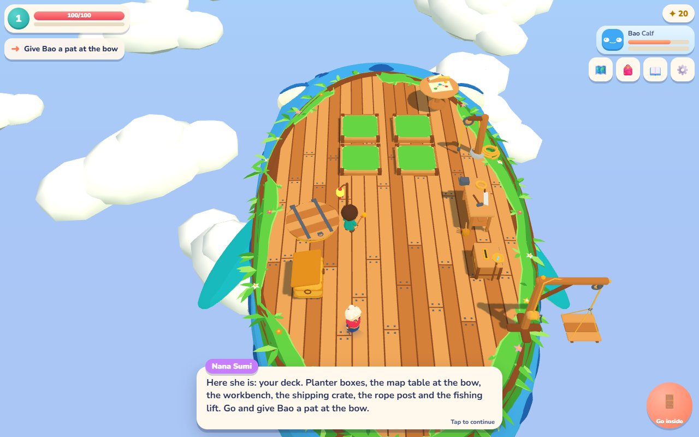
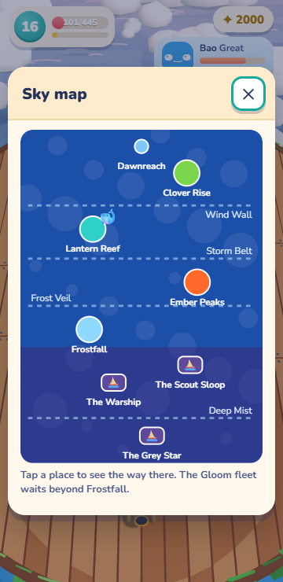
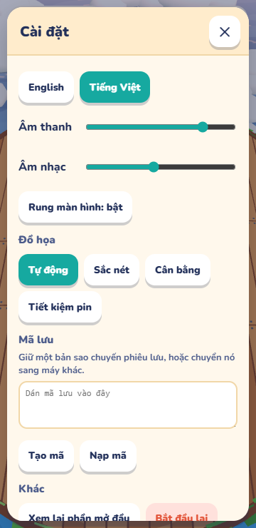
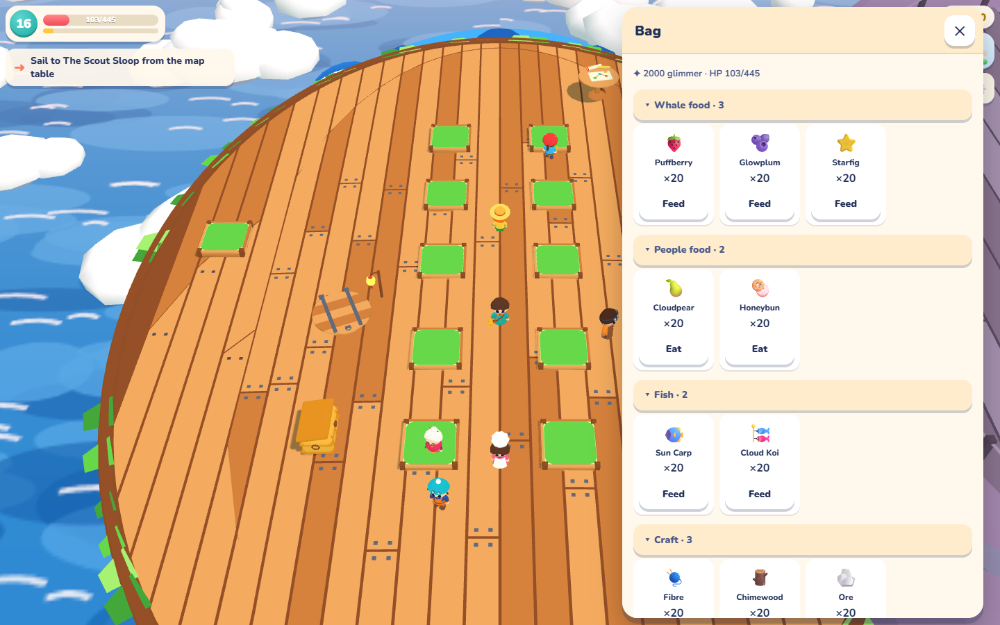

# Phase 0 report — foundations

Date: 2026-10-16. Target: new_cute_game. Reference: ../cute_game (read only).
Base: c84676a. Final implementation: 1ea00be. Report branch: codex/T72.

## Delivered

| Task / cumulative branch | Commit | Result |
|---|---|---|
| T00 / codex/T00 | 54ac907 | Borrowed-role registry, lazy model loader/cache, recursive model packing, inventory consistency test. No art copied. |
| T01 / codex/T01 | a5c1d9d | Typed per-game event bus; successful rule outcomes and deduplicated chapter/goal events; opening-simulation event sequence test. |
| T02 / codex/T02 | 2046700 | Extracted mode, camera, interaction and story systems. Game orchestration is 505 lines, below 600. Existing browser suites passed unchanged at this checkpoint. |
| T03 / codex/T03 | d4e873b | Distance/facing interaction scoring, including doorway preference. Hatch regression tested with the old approach workaround removed. |
| T04 / codex/T04 | 650bc1c | Chained v1 → v2 → v3 migrations; v1/v2 fixtures; malformed, future and missing-migration handling. |
| T05 / codex/T05 | 8681b4f | Shared panel shell, 180 ms motion, reduced motion, focus trap, Escape/back, arrows/controller, desktop docking, tab overflow cues and folding inventory groups. |
| T06 / codex/T06 | 1ea00be | Renderer probe in both browser suites, at phone and desktop sizes, with hard budget assertions. Final review also fixed repeated unsubscribe removing a newer event subscription, with a regression test. |

Each branch carries the preceding task's commits. codex/T72 contains the full phase plus this report. All task branches were pushed after local validation; main was not pushed or merged. No Blender files, reference-repository files, or existing server processes were changed.

## Validation

Every implementation task passed npm test, npm run typecheck, npm run build, scripts/playtest.mjs and scripts/fleet-playtest.mjs before its checkpoint commit. Windows production builds used VITE_BASE_PATH=/new_cute_game/; Vercel preview builds used /.

| Checkpoint | Unit tests passed | Typecheck / build | Both development browser suites |
|---|---:|---|---|
| T00 | 39 | Pass | Pass |
| T01 | 42 | Pass | Pass |
| T02 | 42 | Pass | Pass, without suite changes |
| T03 | 45 | Pass | Pass |
| T04 | 49 | Pass | Pass |
| T05 | 49 | Pass | Pass |
| T06 | 51 | Pass | Pass, including budget tables |

Final production-build browser suites passed at http://127.0.0.1:5362/new_cute_game/?test. The final deterministic budget setup and panel controls were also checked on that build. Development used the existing server on port 5361. No additional server port was opened.

- Opening event order, per-game isolation, successful/failed rule events and idempotent unsubscribe are tested.
- Both historical save fixtures reach the current state, preserve progress and round-trip through export/import. Interrupted raids restart safely.
- Attentive simulation: **47.6 minutes, zero faints, four raids**, finished. Casual: **77.7 minutes, four faints, four raids**, finished. The attentive run meets AGENTS.md's 45–60 minute target. Existing regression bounds remain 25–50 minutes; no pacing rebalance was needed.
- Panel screenshots/audits: all 12 panel kinds plus the market buy tab, in English and Vietnamese, at **360×740 and 1440×900**. No text below 11 CSS px, target below 44 CSS px, or horizontal overflow. SVG text scaling is included; below-fold controls are audited too.
- Panel interaction checks: Tab/Shift-Tab wrapping, arrows, Escape, browser back, controller directions/confirm/back, persisted group folding, scroll cues, reduced motion and desktop docking. T05 preview and final local build passed.
- T02 chapter screenshots were generated and deck/ship views compared with baseline. Scene layout and appearance were retained; animation timing varies between captures.
- A first T06 development run timed out waiting for a probe scene. The probe now pauses gameplay during setup, enters the ship through the existing boardNow test path, closes the completed gameplay page, and reports scene state on entry failure. Subsequent full development suites and the built probe passed. The budgets were not relaxed.

Raw local logs and the full screenshot set are in ignored shots/ (T00–T06 prefixes). Representative images are committed below so the report remains useful on GitHub.

## Render and download budgets

The initial phone baseline was a single settled sample. The final probe takes maxima across 60 rendered frames after scene arrival, with gameplay paused and normal rendering/quality settings retained. Decorative animation and camera framing can change small counts between runs. These are representative scenes, not every possible late-game garden or combat configuration.

| Scene | Before: 360×740 calls / triangles | After: 360×740 calls / triangles | After: 1440×900 calls / triangles | Limit |
|---|---|---|---|---|
| Bao | 45 / 72,463 | 45 / 72,463 | 46 / 72,473 | 140 / 120,000 |
| Clover | 51 / 152,090 | 57 / 152,982 | 55 / 152,344 | 200 / 160,000 |
| Scout Sloop | 39 / 70,565 | 39 / 70,565 | 96 / 83,594 | 200 / 160,000 |

After values are from the final built probe (shots/T06-budget-built.log). All pass. Wider ship framing accounts for its larger desktop draw count.

Packed core models remain **2.78 MB** before and after this phase. Final live transfer before the title screen: **2,162,208 bytes** (including document/resource transfer overhead), with all ten core models loaded. This is below the **3 MB** limit. The earlier T04 live resource-only measurement was 2,159,168 bytes; no pre-Phase-0 network capture was taken, so it is not presented as a phase-start comparison. Hosted HTTP compression explains why transfer is smaller than the packaged files.

## Test deployments

The existing GitHub Pages workflow publishes only from main and was left intact. A separate Vercel project, game1-8059/cloudback-preview, hosts testing builds from static output only.

- [T04 public testing checkpoint](https://cloudback-preview.vercel.app): both live gameplay suites passed. Vercel assigned the first upload as this separate project's production deployment despite the preview request; this is not the existing GitHub Pages site.
- [T05 protected preview](https://cloudback-preview-neebwxujp-game1-8059.vercel.app): ready; live panel interaction checks passed.
- [Final T06 preview](https://cloudback-preview-yjb5z2qp8-game1-8059.vercel.app): ready; final live validation is recorded below. Vercel sign-in may be required for previews.

Deployment settings, environment values and verification cookies remain ignored locally. Requests for /.git/config, /src/game.ts, /.env.local and /art/whale.blend returned 404 on the final deployment. The GitHub repository's existing public visibility was preserved.

Final live validation: **both complete browser suites passed, including all six render-budget rows in each suite, with no page errors**. Logs: shots/T06-live-browser.log and shots/T06-live-fleet.log. All ten core models loaded; mobile/desktop screenshots were inspected.

## Screenshots

### Deck before and after T02

### Panel shell

All generated panel screenshots are in shots/panel-{en,vi}-{360x740,1440x900}-*.png. The complete chapter comparison is in shots/baseline-ch-*.png and shots/T02-*.png. Final live captures are shots/T06-live-phone.png and shots/T06-live-desktop.png.

## Borrowed art and remaining scope

No borrowed models or placeholders were added. BORROWED and its inventory are deliberately empty and checked in both directions. The pre-existing house.glb furniture kit remains in the core loader and is explicitly documented as predating the new registry.

T00–T06 acceptance work is complete. Future phases remain unstarted, including the redesigned phone action layout, maps/quests/pets and replacement art. The pre-existing HUD can show more than three gameplay actions; Phase 0's panel audit does not certify that later HUD redesign. Browser checks use Chromium with phone emulation, not physical iPhone/Android hardware. Shader warm-up and full worst-case scene profiling belong to later polish work. No production merge/deploy to the original site was performed.
